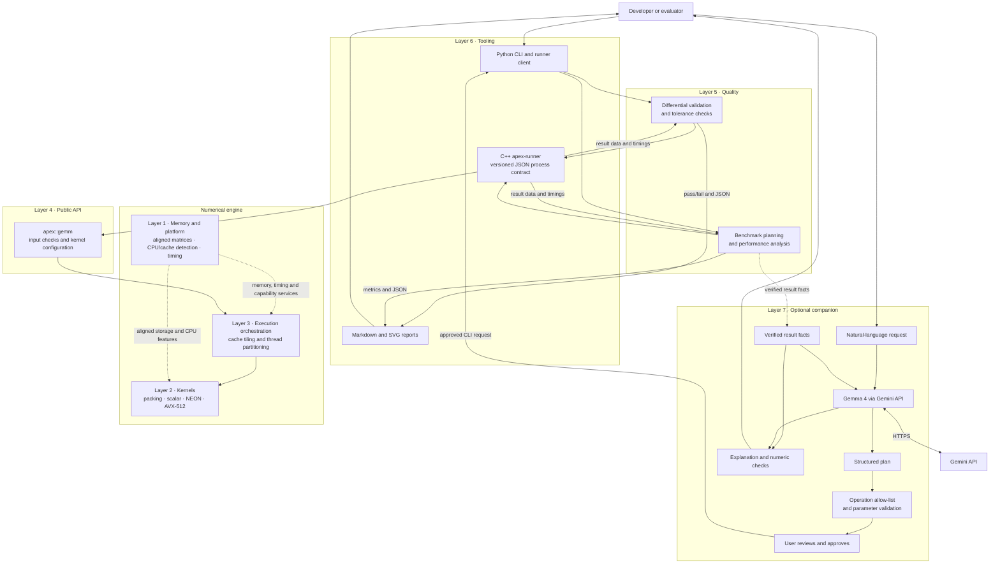
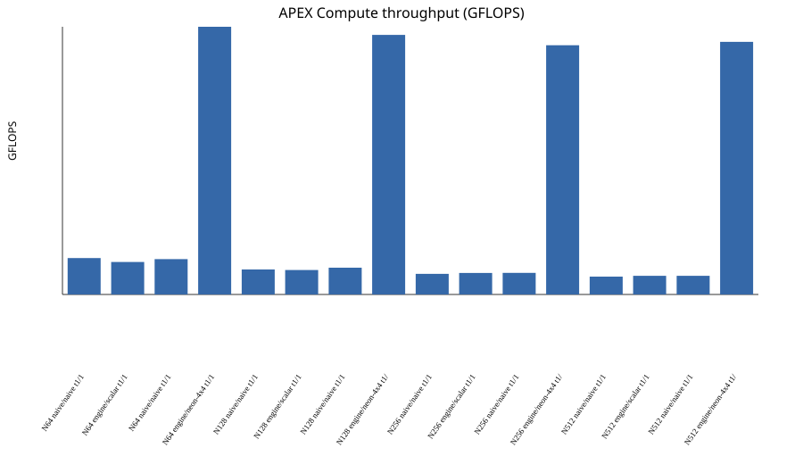
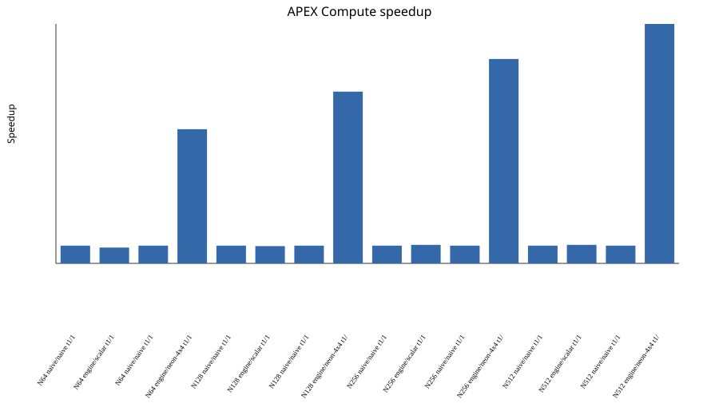

# APEX-COMPUTE

A runtime engine built to accelerate dense matrix multiplication (GEMM) on commodity CPUs via cache tiling, panel packing, and explicit SIMD vectorization (ARM NEON & AVX-512).

## Why this project

Transformer inference repeatedly performs dense matrix multiplication (GEMM) in attention and feed-forward layers. Its practical throughput depends not only on the arithmetic, but also on how data is aligned, reused in cache, and scheduled across the CPU's vector units and cores.

APEX-COMPUTE makes that CPU systems layer visible and measurable. It pairs a portable scalar reference with cache-aware tiling, packed panels, explicit SIMD kernels, and parallel execution, then checks optimized results against a high-precision reference and measures them against a naive baseline. The project focuses on the numerical engine and its evidence.

## Architecture and technology

The design separates machine-level arithmetic from planning, public interfaces, verification, and user-facing tools. Each layer has a defined responsibility; the optional companion sits above the normal CLI workflow and cannot bypass its validated command path.



### Layer responsibilities

| Layer | Responsibility | Main components |
| --- | --- | --- |
| **1 · Memory and Platform** | Provide aligned storage and portable machine information to the engine. | Matrix containers, row strides, CPU/cache features, timer and status codes |
| **2 · Kernel** | Perform the packed tile arithmetic through a common kernel contract. | Scalar fallback, panel packing, ARM NEON and AVX-512 micro-kernels |
| **3 · Execution Orchestration** | Plan cache blocks and coordinate lock-free output-tile work. | Tiling planner, blocked scheduler, thread pool, work partitioner and scratch buffers |
| **4 · Public API** | Expose a stable `apex::gemm` entry point and validate calls. | Matrix inputs, options, dispatch and explicit status results |
| **5 · Quality** | Establish correctness and performance with reproducible evidence. | `apex-validate`, reference comparisons, tolerance policy, `apex-bench` and metrics |
| **6 · Tooling** | Connect Python workflows to compiled code and present the results. | `apex-runner`, runner client, CLI wrappers, JSON contract and Markdown/SVG reports |
| **7 · Companion** | Translate bounded natural-language requests into approved local tool operations. | Gemma 4 planning, allow-list validation, user approval, fact extraction and checked explanations |

### Execution and evidence flow

For a direct run, the CLI selects validation or benchmarking, the Python driver calls `apex-runner` through its versioned process contract, and the runner enters the public API. The API delegates the multiplication to the execution planner and selected micro-kernel; Layer 1 supplies aligned memory and cached platform capabilities. Results return as structured data for validation, performance analysis, and reports.

For a companion request, Gemma proposes a structured plan. The companion validates every operation and parameter against its allow-list, builds a fixed argument list, and presents the plan for approval. The companion invokes the same local CLI path; it cannot replace result data, and explanations are checked against facts extracted from the runner output.

## Quick start

### Requirements

- Git
- CMake 3.21 or newer
- Ninja
- A C++20 compiler: GCC or Clang on Linux, Apple Clang on macOS, or MSVC on Windows
- Python 3 for the Python command-line clients

### Clone and build

```sh
git clone https://github.com/ggaisenn/apex_compute.git
cd apex_compute
cmake --preset release
cmake --build --preset release
```

The `release` preset builds `apex-runner` and `apex-validate` under `build/release/`. The Python clients discover the built runner from CMake's generated runner-location metadata. You can also pass its path with `--runner` or set `APEX_RUNNER`.

### Run the tools

Run a quick differential correctness check:

```sh
python3 apex-validate.py --sizes 16,31,32,33 --kernels auto,scalar --threads 1
```

Run a benchmark and save JSON results, a Markdown table and SVG charts:

```sh
python3 apex-bench.py \
  --sizes 64,128,256,512 \
  --threads 1,2,4 \
  --kernels auto \
  --variants naive,engine \
  --warmup 2 --reps 5 \
  --json-out results/local-benchmark.json \
  --report-out results/report
```

The command prints per-case latency and GFLOPS. The report directory receives a Markdown summary and SVG throughput and speedup charts. For a runner handshake and environment record:

```sh
python3 apex-bench.py --environment
```

The runner also supports direct `info`, `plan`, `run` and `selftest` modes. See the wrappers' built-in help for all supported options:

```sh
python3 apex-validate.py --help
python3 apex-bench.py --help
```

### Build presets

```sh
cmake --preset debug && cmake --build --preset debug
cmake --preset release && cmake --build --preset release
cmake --preset portable && cmake --build --preset portable
cmake --preset asan && cmake --build --preset asan
```

`portable` forces the scalar implementation. `asan` enables AddressSanitizer and UndefinedBehaviorSanitizer where supported. All presets enforce warnings as errors (`/W4 /WX` on MSVC; `-Wall -Wextra -Wpedantic -Werror` on GCC and Clang).


### Using Companion

The companion translates a natural-language request into a small allow-listed plan. It displays the exact local command and waits for approval. After execution, it extracts the result facts and asks Gemini for a plain-language explanation constrained to those facts.

```sh
python -m companion --explain "benchmark a 128 by 128 multiply"
```

### Using Companion Offline Interpreter

Use the companion's recorded offline interpreter for a local run:

```sh
python3 -m companion --offline --yes "validate edge cases"
python3 -m companion --offline --explain --yes "benchmark a small square multiply"
```

The first command uses the checked-in interpretation fixture and runs the real local validator. The second uses a checked-in interpretation and explanation fixture while running the local benchmark. To replay recorded results without a built runner, run:

```sh
python3 -m companion --offline --replay-results --yes "benchmark a small square multiply"
```

### Track alignment

```text
User request
    │
    ▼
Gemma 4 through Gemini API ── proposes structured plan
    │
    ▼
Strict schema + operation allow-list + range/work caps
    │                         (reject unsupported fields/actions)
    ▼
Code-built argv ── user confirmation ── local Python tool process
                                           │
                                           ▼
                                    apex-runner / GEMM
                                           │
                                           ▼
                                    JSON result → facts table
                                           │
                                           ▼
                                    optional Gemma explanation
```


## Performance snapshot

The charts below were generated from a local Release build on macOS arm64 using the auto-selected `neon-4x4` engine kernel. Measurements used warm cache, seed 1, two warm-up runs and five timed repetitions. The runner reports architecture and OS but does not report the exact Mac model, so these are a reproducible sample from that host rather than a universal performance claim.





| M × N × K | Variant | Kernel | Threads requested / used | Latency (ms) | GFLOPS | Speedup |
|---:|:---|:---|---:|---:|---:|---:|
| 64 × 64 × 64 | naive | naive | 1 / 1 | 0.1453 | 3.607 | 1.000× |
| 64 × 64 × 64 | engine | scalar | 1 / 1 | 0.1627 | 3.223 | 0.893× |
| 64 × 64 × 64 | naive | naive | 1 / 1 | 0.1498 | 3.501 | 1.000× |
| 64 × 64 × 64 | engine | neon-4x4 | 1 / 1 | 0.0198 | 26.546 | 7.583× |
| 128 × 128 × 128 | naive | naive | 1 / 1 | 1.6920 | 2.479 | 1.000× |
| 128 × 128 × 128 | engine | scalar | 1 / 1 | 1.7319 | 2.422 | 0.977× |
| 128 × 128 × 128 | naive | naive | 1 / 1 | 1.5824 | 2.651 | 1.000× |
| 128 × 128 × 128 | engine | neon-4x4 | 1 / 1 | 0.1629 | 25.742 | 9.712× |
| 256 × 256 × 256 | naive | naive | 1 / 1 | 16.3972 | 2.046 | 1.000× |
| 256 × 256 × 256 | engine | scalar | 1 / 1 | 15.7115 | 2.136 | 1.044× |
| 256 × 256 × 256 | naive | naive | 1 / 1 | 15.6925 | 2.138 | 1.000× |
| 256 × 256 × 256 | engine | neon-4x4 | 1 / 1 | 1.3579 | 24.711 | 11.557× |
| 512 × 512 × 512 | naive | naive | 1 / 1 | 151.8610 | 1.768 | 1.000× |
| 512 × 512 × 512 | engine | scalar | 1 / 1 | 145.3688 | 1.847 | 1.045× |
| 512 × 512 × 512 | naive | naive | 1 / 1 | 145.0819 | 1.850 | 1.000× |
| 512 × 512 × 512 | engine | neon-4x4 | 1 / 1 | 10.7174 | 25.047 | 13.537× |

The values are medians from the benchmark run on this checkout. Re-run the command above on the target host before comparing results: compiler, CPU model, power mode, thermal state, OS scheduling, selected kernel and matrix sizes all affect throughput. 

A requested thread count can differ from the count reported as used, especially for sizes too small to benefit from parallel work.


## License

APEX-COMPUTE is distributed under the [Apache License, Version 2.0](LICENSE). The repository includes the complete license text.
